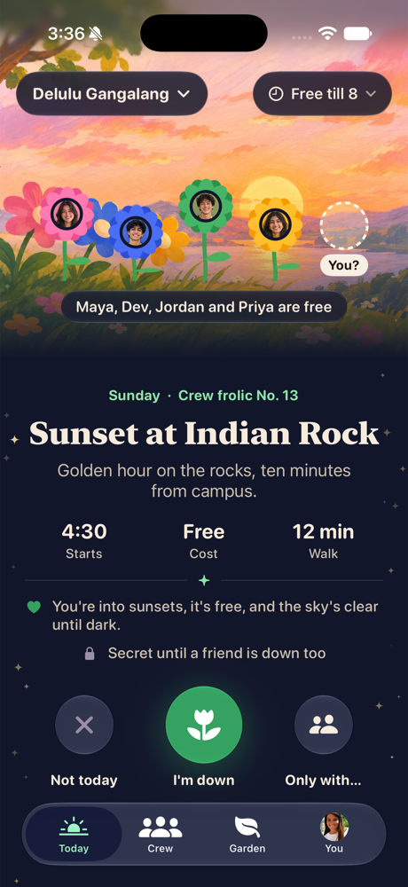
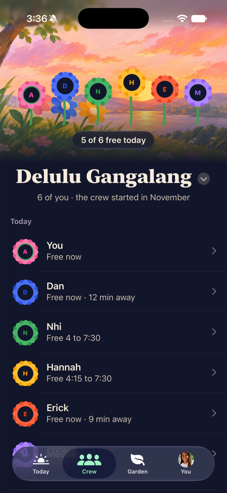
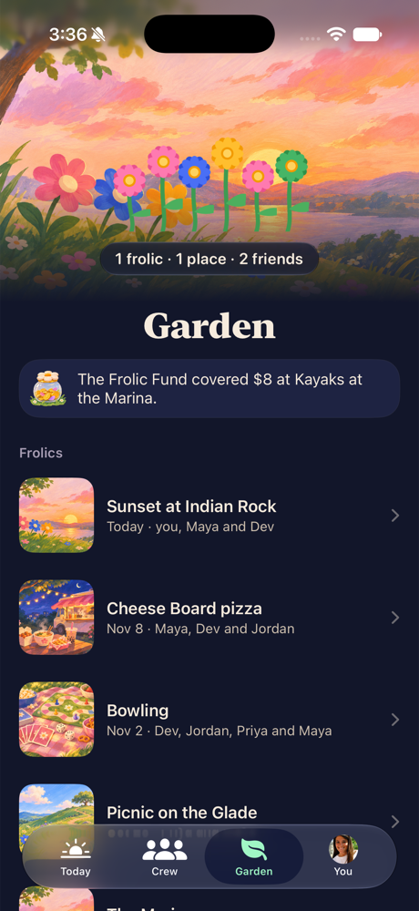
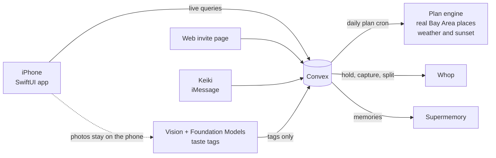
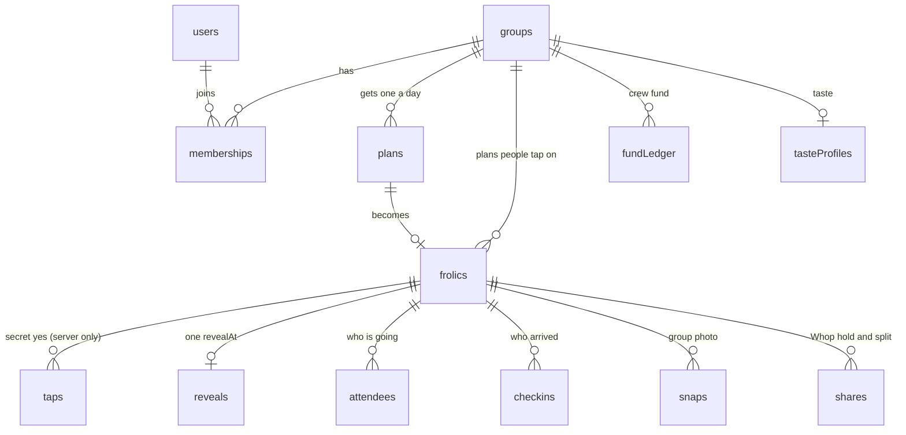

  

<h1 align="center">Frolic</h1>

<b>Frolic plans hangouts for your friend group, so nobody has to ask, nobody has to decide, and nobody flakes.</b>

  
  
  
  

## The problem

Your group chat says "we should hang out" every week, and you never do. Nobody wants to be the one who asks. Nobody can pick what to do. When a plan does happen, someone drops out an hour before.

In the week before the hackathon, we interviewed 100 people about making plans with friends, and read 1,446 TikTok comments on the same topic. Those three pains came up again and again.

## How it works

1. **Every afternoon your crew gets one plan.** A real place nearby, a time, the cost and the walk, picked to fit everyone's budget, distance and curfew, and the crew's taste.
2. **Tap "I'm down."** Nobody sees it. If no friend joins, the plan quietly fades and nobody knows you asked.
3. **Once two of you are down, it's on.** Every phone that said yes flips to **"It's on"** at the same second, with who's coming and when to leave.
4. **Show up.** A $3 hold comes back when you check in. Snap a group photo, and the night grows a flower in your crew's garden.

Free right now? Tap **I'm free now** and Frolic builds a plan for whoever's around.

## Why you'd open it every day

- **One plan lands every afternoon,** so there's always a reason to check.
- **Saying yes costs nothing.** Your yes stays secret until a friend matches it.
- **Your garden grows** with every hangout, and any night shares as an Instagram story.
- **More than one crew:** roommates, your club and your home friends each get their own plan.

## Built with

**Convex** runs the whole backend: 38 tables, live queries, scheduled jobs and crons. The secret yes is built into the data model. No app query can read who tapped. Only the server's matcher sees taps, and it decides a match inside one transaction, so two taps in the same instant can't reveal twice. Every phone keeps a clock offset from the server, so the reveal lands on the same frame everywhere.

**Whop** handles the $3 anti-flake hold, using the full payment lifecycle, not just a checkout button:
- **Hold, then capture or void:** Frolic authorizes the hold at the reveal. Checking in voids it; a no-show captures it.
- **Late cancels and refunds,** each a separate path.
- **A per-crew fund:** no-shows feed it, every credit is traced to a Whop payment ID, and it pays toward the crew's next paid plan.
- **Splits:** a paid plan's cost is split across the friends who matched, with the fund applied first.
- **A signed webhook,** verified on every call, plus a reconcile job that recovers lost or orphaned payments.
- **An Apple Pay page** served from Convex.

Everything runs in the Whop sandbox.

**Supermemory** keeps one memory per person and one per crew: what you skipped, what you loved, where you went. Plans stop offering boba to a crew that skipped it twice, and each plan's "why" quotes a real memory.

**Keiki** is an iMessage agent. A friend who won't install the app can text "down" and gets the same reveal at the same second.

**Capy** agents wrote most of the code. Captain threads ran dozens of parallel workers that opened, tested and merged 160+ pull requests in one day. Each PR links back to the Capy thread that wrote it.

**Revyl** tests the app on cloud iPhones. 48 flows cover signup, the secret yes, the reveal, check-in and the garden.

## Architecture

Your photos never leave the phone. Apple's Vision framework tags them on device, and only the tags (like "sunsets" or "games") reach the server.

The core of the data model:

**Tests:** about 1,270 backend tests, including a 14-day simulation where four people tap, bail, rejoin and flake while every rule holds, and privacy tests that check a secret yes changes nothing another member can query.

Setup, tests and the repo layout live in [`docs/development.md`](docs/development.md).
