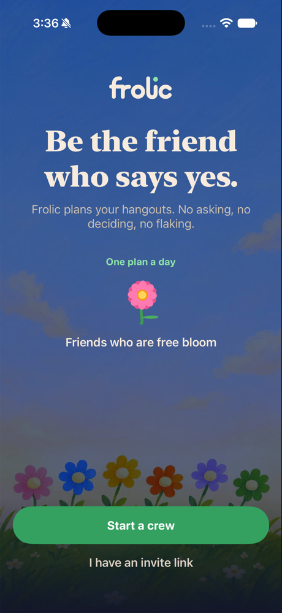
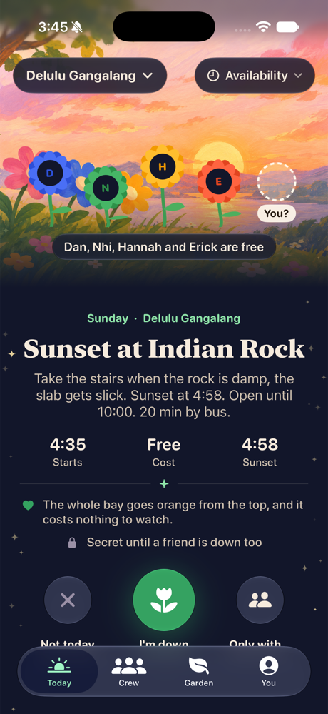
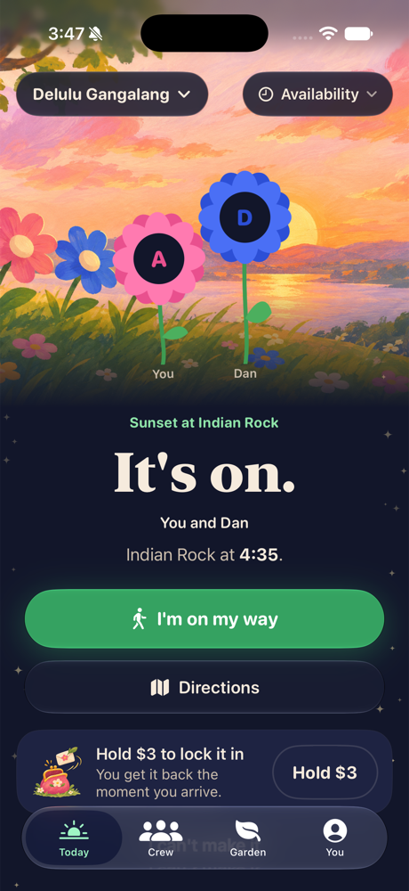
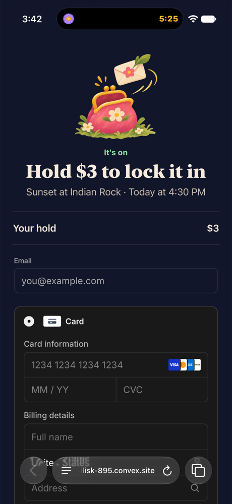
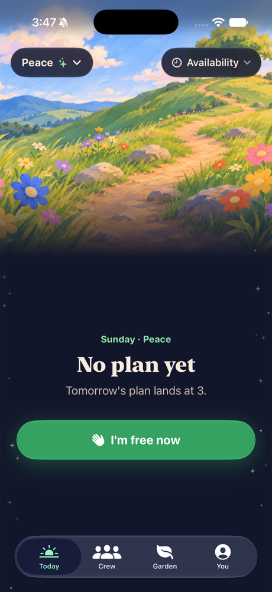
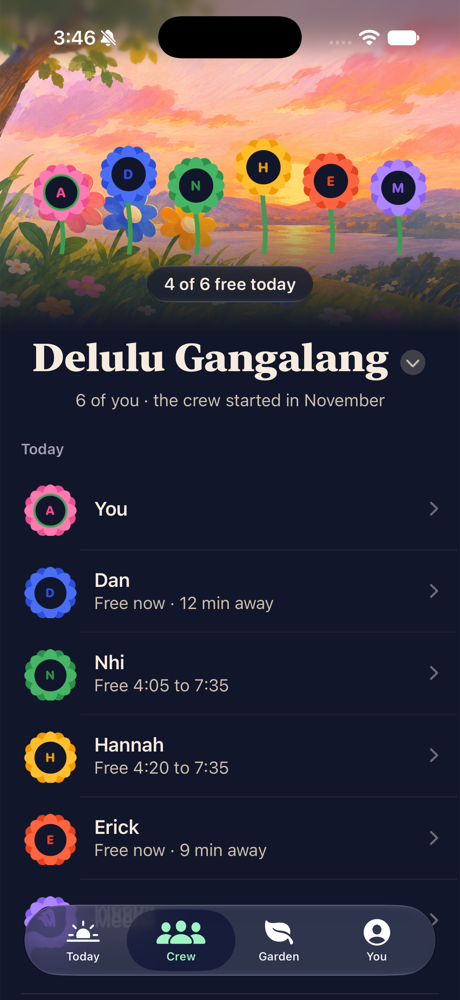
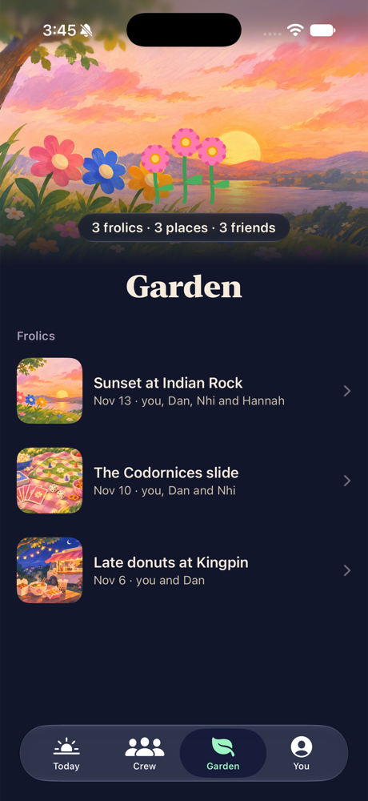
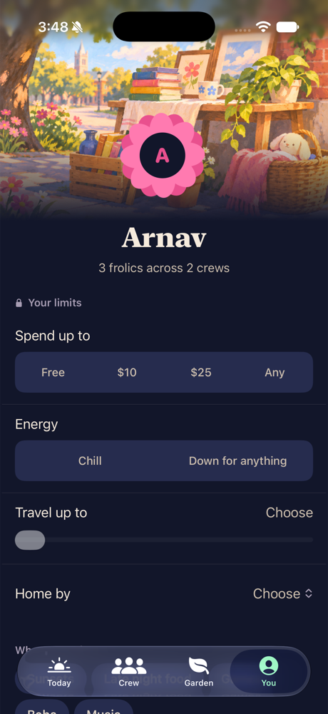
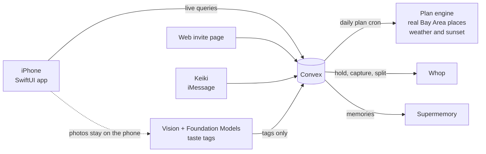
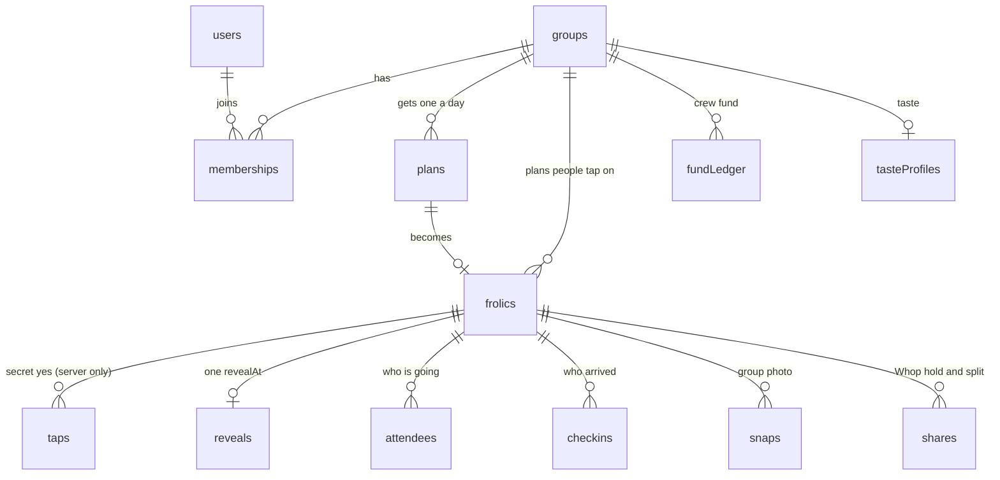

  

<h1 align="center">Frolic</h1>

<b>Frolic plans hangouts for your friend group, so nobody has to ask, nobody has to decide, and nobody flakes.</b>

  
  
  
  

  
  
  
  

## The problem

Every friend group has the same chat. Someone says "we should hang out," everyone agrees, and then nothing happens. Nobody wants to be the one who asks, nobody wants to pick the place, and when a plan finally comes together, someone bails an hour before.

We talked to 100 people about this in the week before the hackathon, and read 1,446 TikTok comments on the same topic. Those three things came up over and over.

## How it works

Every afternoon, your crew gets one plan: a real place nearby, with the time, the cost and how long it takes to get there. Frolic picks it around everyone's budget, how far they'll travel, when they need to be home, and what your crew likes.

If you want to go, tap **I'm down**. Nobody can see that you did. Once a second friend taps it too, it's on, and both your phones flip to "It's on" at the same moment, with who's coming and when to leave. If nobody else bites, the plan fades out and no one ever knows you asked.

To keep people from flaking, going puts a $3 hold on your card, and you get it back when you check in. Take a group photo while you're there and the night grows a new flower in your crew's garden.

If you're free right now, tap **I'm free now** and Frolic will put something together for whoever's around.

## Why you'd come back

There's a new plan every afternoon, so there's a reason to open it every day. Saying yes is free because nobody sees it unless a friend says yes too. The garden fills up as you go out more, and any night can go straight to your Instagram story. You can also be in more than one crew, so your roommates and your club each get their own plan.

## What we built it with

**Convex** is the whole backend. The tricky part was keeping a yes secret: the app has no way to read who tapped. Only the matcher on the server sees taps, and it settles a match in a single transaction, so two people tapping at the same instant can't trigger two reveals. Each phone also tracks its clock offset from the server, which is how the reveal lands at the same moment on everyone's screen.

**Whop** runs the $3 hold. When a plan is on, we authorize the hold. If you check in, we void it. If you don't show, we capture it, and that money goes into a fund for your crew that pays toward its next paid plan. Paid plans get split between the people going, with the fund taken off first. Every credit in the fund points back to a Whop payment. We verify the signature on every webhook, and a reconcile job catches payments that got lost along the way. The checkout page with Apple Pay is served from Convex. It all runs in Whop's sandbox.

**Supermemory** remembers what each person and each crew skipped, loved and went to. That's why a crew that passed on boba twice stops getting boba, and why each plan's "why" line can point to something real.

**Keiki** puts Frolic in iMessage. A friend who won't download the app can text "down" and gets the reveal at the same time as everyone else.

**Capy** agents wrote most of the code. Captain threads ran dozens of workers in parallel and merged more than 160 pull requests in one day. Each PR links to the Capy thread that wrote it.

**Revyl** runs the app on cloud iPhones. There are 48 test flows covering signup, the secret yes, the reveal, check-in and the garden.

## Architecture

Your photos stay on your phone. Apple's Vision framework tags them there, and only the tags, like "sunsets" or "games," get sent to the server.

Here are the main tables:

The backend has about 1,270 tests. One simulates four people over 14 days, tapping, bailing, rejoining and flaking, and checks that the rules hold the whole time. Others make sure a secret yes doesn't change anything another member can see.

Setup instructions and the repo layout are in [`docs/development.md`](docs/development.md).
